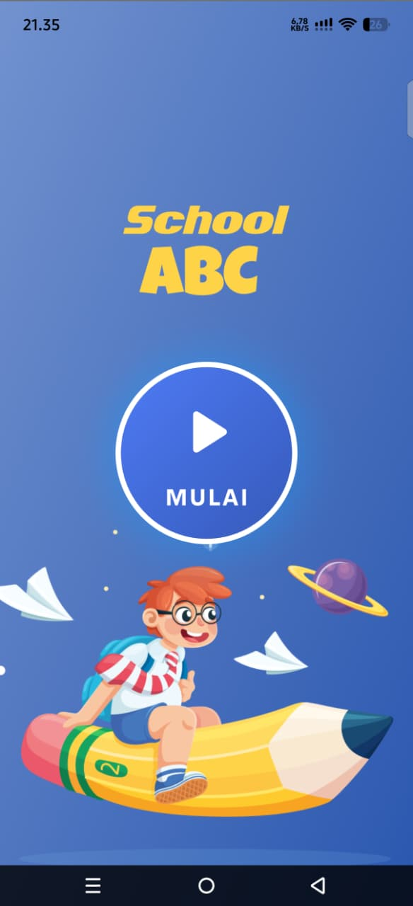
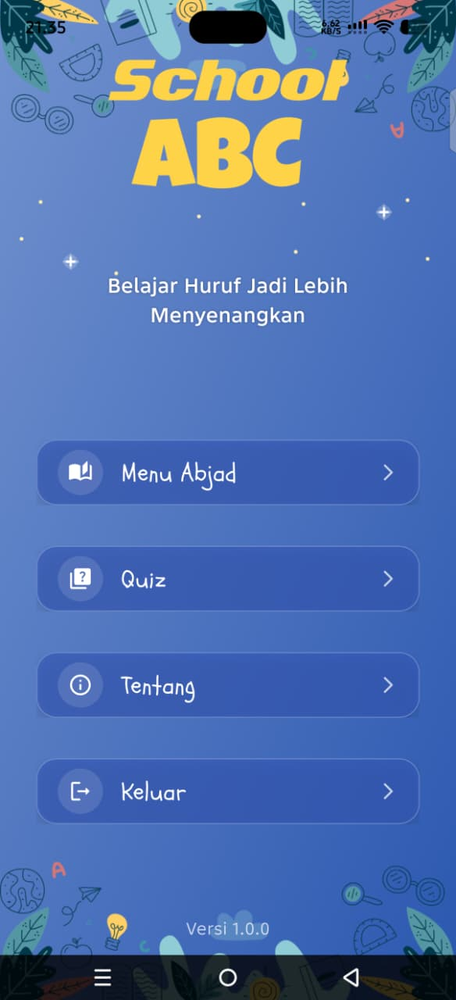
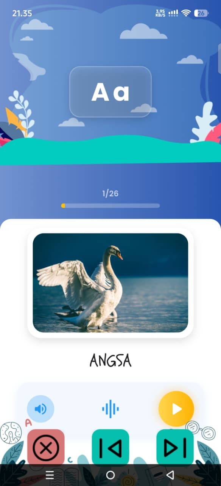
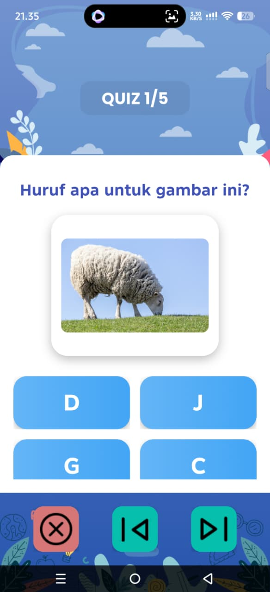

# 📚 School ABC

**School ABC** adalah aplikasi pembelajaran abjad Bahasa Indonesia berbasis Android yang dirancang secara interaktif dengan ilustrasi hewan untuk membantu anak-anak mengenal dan mempelajari huruf alfabet.

Aplikasi ini dikembangkan menggunakan Flutter dengan fitur pembelajaran abjad dan kuis interaktif. Pada fitur kuis, diterapkan algoritma **Linear Congruent Method (LCM)** untuk mengacak urutan soal.

## ✨ Features

- **Splash Screen** — Halaman pembuka aplikasi.
- **Main Menu** — Navigasi menuju fitur utama aplikasi.
- **Abjad Learning** — Pembelajaran huruf alfabet Bahasa Indonesia dengan ilustrasi hewan.
- **Interactive Quiz** — Kuis interaktif untuk menguji pemahaman pengguna.
- **Linear Congruent Method (LCM)** — Metode pengacakan urutan soal pada sesi kuis.

## 🛠️ Built With

- Flutter
- Dart
- Android SDK
- Linear Congruent Method (LCM)

## 📱 Application Screenshots

### 1. Splash Screen

Halaman pembuka aplikasi dengan tombol Mulai.

### 2. Main Menu

Halaman utama yang menyediakan navigasi ke fitur pembelajaran dan kuis.

### 3. Abjad Learning

Fitur pembelajaran abjad Bahasa Indonesia dengan ilustrasi hewan.

### 4. Interactive Quiz

Fitur kuis interaktif dengan penerapan metode Linear Congruent Method (LCM) untuk mengacak urutan soal.

## 📥 Download Application

Unduh aplikasi School ABC versi Android melalui halaman GitHub Releases.

[**Download School ABC v1.0.0 (APK)**](https://github.com/mubinsy-gt/School-ABC/releases/tag/v1.0.0)

## 🚀 Installation

1. Download file APK dari halaman Releases.
2. Buka file APK pada perangkat Android.
3. Izinkan instalasi aplikasi dari sumber yang tidak dikenal jika diminta.
4. Selesaikan instalasi dan buka School ABC.

## 👨‍💻 Developer

**Muhammad Bintang Syakhila**

Developed as an educational application project using Flutter.
